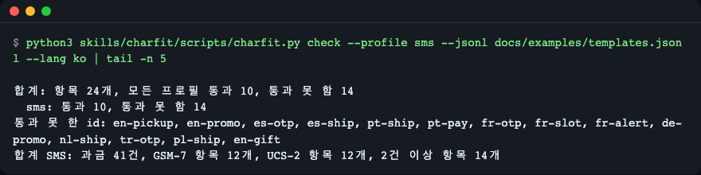
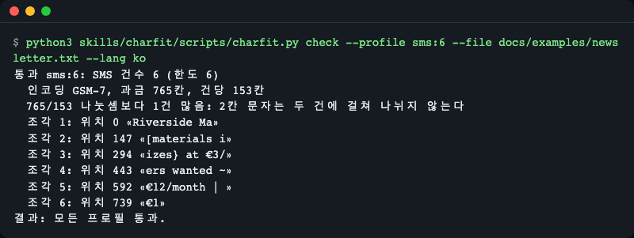
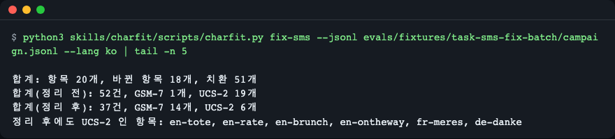
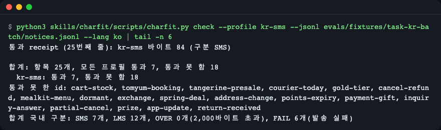
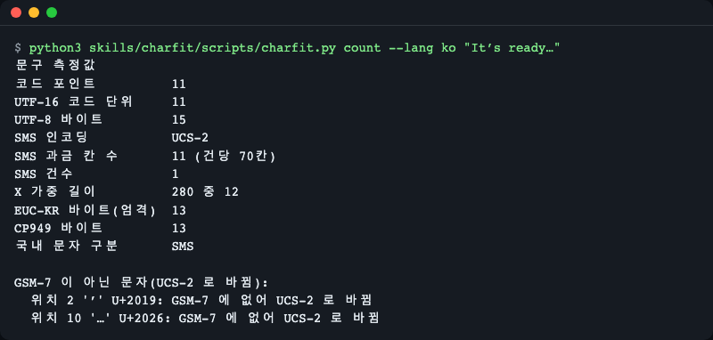

# charfit

[English](README.md) | **한국어**

통신사가 과금하는 방식 그대로 문자 메시지 길이를 재 주는 에이전트 스킬입니다. 표준 라이브러리만 쓰는 Python 스크립트가 들어 있습니다. 문구 하나든 `templates.jsonl` 한 파일이든 맡기면 과금 건수(GSM-7·UCS-2), 각 조각이 시작하는 위치, 국내 SMS/LMS 의 엄격한 EUC-KR 구분, 그리고 합계를 돌려줍니다. 에이전트가 직접 더하지 않고 스크립트의 숫자를 그대로 보고합니다. 오프라인에서 돌고 항상 같은 답을 냅니다.


*현지화 템플릿 24개를 한 번에 확인합니다. 마지막 줄이 답입니다: 과금 41건, UCS-2 로 바뀐 항목 12개.*

## 무엇을 하나요

언어 모델은 글자가 아니라 토큰 단위로 세고, 기억으로 만든 GSM-7 표나 `len()`, `ceil(n / 153)` 은 통신사의 규칙이 아닙니다. 묶음은 항목 하나만 틀려도 합계가 틀리므로, `charfit` 은 에이전트가 물어볼 스크립트를 줍니다.

- **묶음을 한 번에.** `--jsonl templates.jsonl` 은 한 줄에 `{"id", "text"}` 객체 하나씩 읽고, 항목별 결과와 `totals`(과금 건수, GSM-7·UCS-2 항목 수, 2건 이상 항목 수, 통과 못 한 id)를 냅니다.
- **정확한 GSM-7 소속.** `é` 는 GSM-7 이고 `á` 는 아닙니다. `á` 하나 때문에 120자 문구가 1건에서 2건이 됩니다. 표는 3GPP TS 23.038 을 따르고 `gsm0338` 코덱과 대조했습니다.
- **조각이 시작하는 위치.** `segment_starts` 는 각 조각이 시작하는 문자 위치를 나열합니다. 2칸 문자(`€`, `[`, 이모지)는 쪼개지 않으므로 시작 위치가 153·67 의 배수가 아닙니다.
- **GSM-7 정리 뒤 다시 측정.** `fix-sms` 는 굽은 따옴표·대시·`…`·특수 공백을 바꾸고, 결과를 다시 재서 정리 전후 합계를 보여 줍니다. `…` 는 `...`(3칸)이 되므로 오히려 길어지는 문구도 있습니다.
- **국내 SMS/LMS 의 엄격한 EUC-KR.** Python 의 `euc_kr` 코덱은 `똠` 처럼 국내 통신사가 보낼 수 없는 한글도 인코딩합니다. `charfit` 은 그런 문구를 `FAIL` 로 표시하고, 묶음에서 `SMS`(90바이트)·`LMS`(2,000바이트)·`OVER`·`FAIL` 개수를 셉니다. `--kr-codec cp949` 로 확장 한글 기준 바이트도 볼 수 있습니다.
- **그 밖의 한도.** `utf16:N`·`utf8:N`·`chars:N` 프로필, X 용 `x-post` 프로필(주의 사항은 [언제 쓰나요](#언제-쓰나요) 참고).
- **영어·한국어 출력.** `--lang en|ko`, `CHARFIT_LANG` 환경변수, 로케일 순으로 정합니다. `--json` 은 두 언어에서 바이트 단위로 같습니다.

에이전트가 즉석에서 스크립트를 쓰면 안 되나요? 저장소의 테스트 파일에서 지름길이 내는 답은 이렇습니다(지름길은 [`tests/naive_baselines.py`](tests/naive_baselines.py) 에 코드로 있습니다).

| 질문 | 지름길 | 지름길의 답 | `charfit` |
|---|---|---|---|
| 현지화 템플릿 24개의 과금 건수, UCS-2 항목 수 | "라틴 문자는 GSM-7" | 34건, UCS-2 5개 | **41건, UCS-2 12개** |
| 765칸 뉴스레터의 조각 수와 3번째·마지막 조각 시작 위치 | 칸 수를 153 으로 나누기 | 5건, 295, 593 | **6건, 294, 739**(문자 위치) |
| 캠페인 문구 20개를 GSM-7 로 정리한 뒤 건수 | 정리한 뒤 153 또는 67 로 나누기 | 33건 | **37건** |
| 보낼 수 없는 국내 알림(25개, 엄격 EUC-KR) | `encode("euc_kr")` | 3개 | **6개** |

## 설치

전제: Python 3.9 이상(표준 라이브러리만 사용하므로 따로 설치할 것이 없습니다). 테스트를 돌릴 때만 `uv` 가 필요합니다: `curl -LsSf https://astral.sh/uv/install.sh | sh`.

**Claude Code**
```
/plugin marketplace add LeeGyeongPil/charfit
/plugin install charfit@charfit-skill
```

**Agent Skills 표준을 읽는 다른 에이전트** — `skills/charfit` 을 에이전트의 스킬 폴더(예: 프로젝트의 `.agents/skills/`)에 복사합니다.

에이전트 없이 스크립트를 바로 실행할 수도 있습니다.

```
git clone https://github.com/LeeGyeongPil/charfit.git
cd charfit
python3 skills/charfit/scripts/charfit.py count "It’s ready…"
```

## 사용하기

에이전트에게 평소 말투로 요청하세요. 아래는 스킬의 발동 평가 세트에 있는 요청입니다.

- "How many SMS segments will this message be billed as? ..."
- "Why is my 120-character text message being sent as 2 parts? ..."
- "Make this promo text GSM-7 safe; replace the smart quotes and ellipsis if needed: ..."
- "이 문구 문자로 보내면 몇 건으로 나가? 이모지 들어가도 괜찮아?"

템플릿 파일이 있으면 파일 이름을 함께 주세요. 에이전트가 묶음 모드로 실행합니다. 아래 명령은 저장소 루트에서 실행하고, 샘플 파일은 `evals/fixtures/` 와 `docs/examples/` 에 있습니다.

**1. 템플릿 묶음** (`check --jsonl`; 종료 코드 0 = 모든 항목 통과, 1 = 통과 못 한 항목이 있음):

```
$ python3 skills/charfit/scripts/charfit.py check --profile sms --jsonl evals/fixtures/task-sms-locales/templates.jsonl --lang ko
통과 en-otp (1번째 줄): sms SMS 건수 1 (GSM-7, 111칸, 조각 시작 위치 0)
통과 en-ship (2번째 줄): sms SMS 건수 1 (GSM-7, 104칸, 조각 시작 위치 0)
실패 en-pickup (3번째 줄): sms SMS 건수 2 (UCS-2, 120칸, 조각 시작 위치 0, 67)
  - 위치 10 '’' U+2019: GSM-7 에 없어 UCS-2 로 바뀜
...
```

위는 실제 출력의 앞부분이고, 끝부분은 다음과 같습니다.

```
$ python3 skills/charfit/scripts/charfit.py check --profile sms --jsonl evals/fixtures/task-sms-locales/templates.jsonl --lang ko
...
합계: 항목 24개, 모든 프로필 통과 10, 통과 못 함 14
  sms: 통과 10, 통과 못 함 14
통과 못 한 id: en-pickup, en-promo, es-otp, es-ship, pt-ship, pt-pay, fr-otp, fr-slot, fr-alert, de-promo, nl-ship, tr-otp, pl-ship, en-gift
합계 SMS: 과금 41건, GSM-7 항목 12개, UCS-2 항목 12개, 2건 이상 항목 14개
```

(`...` 는 여기서 생략한 줄입니다.) `--json` 을 붙이면 같은 합계를 기계가 읽을 수 있습니다. `totals.sms` 는 `{"segments": 41, "gsm7": 12, "ucs2": 12, "multi_segment": 14}` 이고, 에이전트는 이 값을 그대로 인용합니다.

**2. 조각은 어디서 시작하나요?** (`check --profile sms:6` 은 최대 6건까지 허용):

```
$ python3 skills/charfit/scripts/charfit.py check --profile sms:6 --file docs/examples/newsletter.txt --lang ko
통과 sms:6: SMS 건수 6 (한도 6)
  인코딩 GSM-7, 과금 765칸, 건당 153칸
  765/153 나눗셈보다 1건 많음: 2칸 문자는 두 건에 걸쳐 나뉘지 않는다
  조각 1: 위치 0 «Riverside Ma»
  조각 2: 위치 147 «[materials i»
  조각 3: 위치 294 «izes} at €3/»
  조각 4: 위치 443 «ers wanted ~»
  조각 5: 위치 592 «€12/month | »
  조각 6: 위치 739 «€1»
결과: 모든 프로필 통과.
```


*글자는 741자(`--file` 은 끝의 줄바꿈 하나를 무시하므로 `wc -m` 은 742)인데 과금 칸은 765칸입니다. `[`·`€` 같은 24자가 2칸이기 때문입니다. 그리스 대문자 `Ω` 와 `§` 는 GSM-7 알파벳에 있어서 1칸이고, 메시지는 GSM-7 로 남습니다. 765 는 153 × 5 와 딱 같지만 6건이 필요합니다. 5번째 조각이 152칸까지 찬 자리에서 `€` 가 시작하고, 2칸 문자는 경계에 걸쳐 나뉘지 않으므로 통째로 6번째 조각으로 넘어갑니다. 2번째 조각이 153 이 아니라 147 에서 시작하는 것도 같은 이유입니다.*

**3. 묶음을 GSM-7 로 정리** (`fix-sms --jsonl`; 종료 코드 1 은 정리한 뒤에도 UCS-2 항목이 남았다는 뜻이고, 여기서는 이모지·`ê`·아포스트로피 대신 쓴 역따옴표 때문입니다). 출력의 끝부분:

```
$ python3 skills/charfit/scripts/charfit.py fix-sms --jsonl evals/fixtures/task-sms-fix-batch/campaign.jsonl --lang ko
...
합계: 항목 20개, 바뀐 항목 18개, 치환 51개
합계(정리 전): 52건, GSM-7 1개, UCS-2 19개
합계(정리 후): 37건, GSM-7 14개, UCS-2 6개
정리 후에도 UCS-2 인 항목: en-tote, en-rate, en-brunch, en-ontheway, fr-meres, de-danke
```


*정리로 15건이 줄지만 6개 항목은 사람이 고쳐 써야 합니다. `en-tote` 는 아포스트로피 자리에 역따옴표(U+0060)를 썼는데, 역따옴표는 GSM-7 이 아닙니다. 정리는 곡선 따옴표만 바꾸므로 역따옴표는 그대로 둡니다. 스크립트는 파일을 고치지 않습니다.*

**4. 엄격한 EUC-KR 로 보는 국내 알림** (`kr-sms` 는 90바이트, `kr-lms` 는 2,000바이트이고, 인코딩할 수 없는 문구는 `FAIL`). 출력의 끝부분:

```
$ python3 skills/charfit/scripts/charfit.py check --profile kr-sms --jsonl evals/fixtures/task-kr-batch/notices.jsonl --lang ko
...
통과 receipt (25번째 줄): kr-sms 바이트 84 (구분 SMS)

합계: 항목 25개, 모든 프로필 통과 7, 통과 못 함 18
  kr-sms: 통과 7, 통과 못 함 18
통과 못 한 id: cart-stock, tomyum-booking, tangerine-presale, courier-today, gold-tier, cancel-refund, mealkit-menu, dormant, exchange, spring-deal, address-change, points-expiry, payment-gift, inquiry-answer, partial-cancel, prize, app-update, return-received
합계 국내 구분: SMS 7개, LMS 12개, OVER 0개(2,000바이트 초과), FAIL 6개(발송 실패)
```


*"통과 못 함"(18)은 90바이트를 넘었거나 인코딩할 수 없다는 뜻이고, `FAIL`(6)은 통신사 구분으로 아예 보낼 수 없는 문구입니다.*

**5. 문구 하나** (`count` 는 모든 측정값을 보여 줍니다. `check`·`fix-sms` 도 문구 하나, `--file PATH`, 표준 입력 `-` 을 받습니다):

```
$ python3 skills/charfit/scripts/charfit.py count --lang ko "It’s ready…"
문구 측정값
코드 포인트          11
UTF-16 코드 단위     11
UTF-8 바이트         15
SMS 인코딩           UCS-2
SMS 과금 칸 수       11 (건당 70칸)
SMS 건수             1
X 가중 길이          280 중 12
EUC-KR 바이트(엄격)  13
CP949 바이트         13
국내 문자 구분       SMS

GSM-7 이 아닌 문자(UCS-2 로 바뀜):
  위치 2 '’' U+2019: GSM-7 에 없어 UCS-2 로 바뀜
  위치 10 '…' U+2026: GSM-7 에 없어 UCS-2 로 바뀜
```


*굽은 따옴표 하나와 말줄임표 하나가 GSM-7 문자를 UCS-2(건당 160칸이 아니라 70칸)로 바꿉니다.*

### `--jsonl` 입력 형식

한 줄에 JSON 객체 하나이고, `text` 는 필수이며 문자열이어야 합니다. `id` 는 선택(문자열 또는 정수, 없으면 줄 번호)입니다. 빈 줄은 건너뜁니다. 잘못된 입력은 줄 번호와 함께 종료 코드 2 로 멈추며 트레이스백은 나오지 않습니다. `--jsonl` 은 TEXT·`-`·`--file` 과 함께 쓸 수 없습니다.

```
{"id": "en-otp", "text": "Lumora: your sign-in code is 482019."}
{"id": "es-otp", "text": "Lumora: tu código es 482019."}
```

## 프로필

`--profile P[,P...]` 로 확인할 한도를 고릅니다. 여러 개를 함께 쓸 수 있습니다.

| 프로필 | 단위 | 한도 | 출처 |
|---|---|---|---|
| `sms` | 과금 건수 | 1건: GSM-7 160칸, UCS-2 70칸(나뉘면 건당 153 / 67칸) | [3GPP TS 23.038](https://www.3gpp.org/ftp/Specs/archive/23_series/23.038/), [Twilio](https://www.twilio.com/docs/glossary/what-sms-character-limit) |
| `sms:N` | 과금 건수 | 최대 N건 | 같음 |
| `kr-sms` | 엄격한 EUC-KR 바이트 | 90 | [NHN Cloud](https://docs.nhncloud.com/en/Notification/SMS/en/api-guide-v2.4/), [Solapi](https://solapi.com/guides/sms) |
| `kr-lms` | 엄격한 EUC-KR 바이트 | 2,000 | 같음 |
| `utf16:N` | UTF-16 코드 단위(HTML `maxlength`) | N | [MDN](https://developer.mozilla.org/en-US/docs/Web/HTML/Reference/Attributes/maxlength) |
| `utf8:N` | UTF-8 바이트 | N | 해당 없음 |
| `chars:N` | 코드 포인트 | N | 해당 없음 |
| `x-post` | 가중 길이(근사) | 280 | [X 문서](https://docs.x.com/fundamentals/counting-characters) |

## JSON 출력과 종료 코드

`--json` 의 키는 영어이고 두 언어에서 같습니다. 문구 하나의 결과에서 중요한 필드만 줄인 예(`"Tu código es 4821"`, `--profile sms`):

```
$ python3 skills/charfit/scripts/charfit.py check --profile sms --json "Tu código es 4821"
{
  "pass": true,
  "length": {"code_points": 17, "utf16_units": 17, "utf8_bytes": 18},
  "results": [{
    "profile": "sms", "pass": true, "measure": "sms_segments",
    "value": 1, "limit": 1, "over": 0,
    "culprits": [{"index": 4, "char": "ó", "codepoint": "U+00F3", "reason": "not_gsm7"}],
    "encoding": "UCS-2", "units": 17, "per_segment": 70,
    "extension_chars": 0, "boundary_extra": 0, "segment_starts": [0]
  }]
}
```

(실제 출력은 여러 줄로 들여써서 나오며 값은 같습니다.)

- `results[].value`·`limit`·`over`·`pass`: 측정값, 한도, 초과한 양, 통과 여부. 보낼 수 없는 국내 문구는 `value` 와 `over` 가 `null` 입니다.
- `culprits`: UCS-2 로 바꾸는(또는 인코딩할 수 없는) 문자. 0부터 시작하는 코드 포인트 `index`, `codepoint`, `reason` 이 있습니다.
- `segment_starts`: 각 조각이 시작하는 코드 포인트 위치(빈 문구는 `[]`).
- `boundary_extra`: "2칸 문자는 쪼개지 않는다" 규칙 때문에 `ceil(칸 수 / 건당 칸 수)` 보다 늘어난 건수. `0` 이면 경계 영향이 없습니다.
- `--jsonl` 은 `items` 와 `totals` 를 더합니다([`--jsonl` 입력 형식](#--jsonl-입력-형식) 참고).

종료 코드: `0` 모든 항목 통과, `1` 한도 초과(`fix-sms` 는 정리 뒤에도 UCS-2 항목이 남음), `2` 사용법·입력 오류(`charfit: error:` 한 줄, 트레이스백 없음).

## 언어와 옵션

| 설정 | 값 | 비고 |
|---|---|---|
| `--json` | 플래그 | 기계가 읽는 출력 |
| `--kr-codec` | `euc-kr`(기본, 엄격) 또는 `cp949` | `cp949` 는 확장 한글을 2바이트로 셉니다. 게이트웨이가 받는 것을 알 때만 쓰세요 |
| `--lang` | `en` 또는 `ko` | 다음은 `CHARFIT_LANG`, `LC_ALL`·`LC_MESSAGES`·`LANG`(`ko` 로 시작하면 한국어, 그 밖은 영어) |

## 검증 결과

<!-- skill-eval:start -->
| 확인 | 결과 |
|---|---|
| 필요할 때 불림 | 12/12 |
| 필요 없을 때 안 불림 | 12/12 |
| 스킬로 푼 작업 | 5/5 |
| 스킬 없이 푼 작업(기준선) | 1/5 |
| 평균 점수 차이(Δ) | +0.42 |
| 가짜 스크립트를 잡아낸 비율 | 5/5 |
| Codex CLI | 미검증 |

Claude Code 2.1.332 · sonnet · 케이스마다 3회 · 2026-11-27 측정 · codex-cli 0.154.0
<!-- skill-eval:end -->

## 동작 원리


1. 요청이 SMS 의 길이·비용이나 다른 문자 수 한도에 관한 것이면 에이전트가 `SKILL.md` 를 읽습니다.
2. 문구가 여러 개면 반복문 대신 `--jsonl` 한 번으로 실행하고, 하나면 문구나 `--file` 을 넘깁니다.
3. 스크립트는 인자·선택한 파일·표준 입력만 읽고, 항목별 값·원인 글자·`segment_starts`·`totals` 를 출력합니다. 종료 코드 1 은 한도 초과입니다.
4. 에이전트는 그 값을 그대로 보고합니다. 조각 수를 더하거나 칸 수를 나누지 않습니다.

네트워크 접근 없음, 도구가 쓰는 파일 없음(스크립트를 직접 실행하면 옆에 `__pycache__` 폴더가 생길 수 있음), Python 외의 패키지 없음. 규칙과 출처는 [`skills/charfit/references/rules.md`](skills/charfit/references/rules.md) 에 있습니다.

## 규칙과 한계

- GSM-7 은 127자 기본 알파벳과, 2칸을 차지하는 확장표(`^ { } \ [ ~ ] |`, 폼 피드, `€`)입니다. 둘 다에 없는 문자가 하나라도 있으면 메시지 전체가 UCS-2 가 되고, UTF-16 칸으로 셉니다(이모지는 2칸).
- 악센트 문자와 그리스 대문자는 일부만 GSM-7 입니다(`gsm0338` 1.1.0 코덱과 대조):

| GSM-7 (1칸) | GSM-7 아님 (메시지가 UCS-2 로 바뀜) |
|---|---|
| é è ù ì ò à ä ö ü ñ ß å ø æ | á í ó ú â ê î ô û ã õ ë ï ÿ œ |
| É Ä Ö Ü Ñ Å Ø Æ Ç | À È Ì Ò Ù Á Í Ó Ú |
| ¡ ¿ £ ¥ § ¤ | ç(소문자), ł ş ğ ı ő |
| Δ Φ Γ Λ Ω Π Ψ Σ Θ Ξ (그리스 대문자) | 나머지 그리스 문자(라틴 문자처럼 생긴 대문자 Α Β Ε … 포함), 역따옴표 U+0060 |

- 소문자 `ç`: 3GPP 표에는 대문자 `Ç` 만 있습니다. 일부 사업자는 `ç` 를 그 자리에 대응시키지만 `charfit` 은 표를 따라 `ç` 를 UCS-2 로 봅니다.
- X: `x-post` 는 X 가 공개한 규칙의 근사이고 twitter-text 3.1.0 과 대조했습니다(테스트 토큰 183개 중 180개 일치). 모든 X 클라이언트와 같다고 보장하지 않습니다.
- 지원하지 않음: 국가별 GSM shift 표(터키어·스페인어·포르투갈어), 수신자 부담 152/66 한도, 사업자 저장 한도와 템플릿 규칙, 그래핌 수 세기. 게이트웨이가 다르게 세거나 변환할 수 있습니다.

전체 규칙은 [`skills/charfit/references/rules.md`](skills/charfit/references/rules.md) 에 있습니다.

## 언제 쓰나요

- 잘 맞는 경우: 여러 언어 템플릿의 조각 합계가 비용을 좌우할 때, 긴 공지의 분할 지점이 필요할 때, CMS 에서 붙여 넣은 캠페인 문구를 정리할 때, 엄격한 EUC-KR 을 통과해야 하는 국내 SMS/LMS.
- 다루지 않는 것: 단어 수, LLM 토큰 수, 메시지 발송, 번역, 국가별 GSM shift 표, 수신자 부담 조각 한도(미국·캐나다), 그래핌 수 세기.
- X 에 관한 주의: `x-post` 프로필은 X 가 공개한 가중치 규칙의 근사이고 twitter-text 3.1.0 과 대조했습니다. 이모지 시퀀스와 국가 코드 파일 이름은 모든 X 클라이언트와 같다고 보장하지 않으며, 이 도구의 중심 기능이 아닙니다.
- LLM 토큰 수는 호출하는 모델의 토크나이저를 쓰고, SMS 발송은 사업자의 API 를 쓰세요. `charfit` 은 측정만 합니다.

## 개발

```
uv sync && uv run pytest
```

`evals/` 폴더에는 발동 케이스 12개, 미발동 케이스 12개(근접 8개), 작업 케이스 5개와 픽스처(케이스가 쓰는 파일)가 있습니다. `claude plugin eval` 로 돌립니다(Claude Code 문서 참고).

## 출처

모두 2026-11-23 에 확인했습니다.

- 3GPP TS 23.038 (GSM-7 알파벳): https://www.3gpp.org/ftp/Specs/archive/23_series/23.038/
- Twilio, SMS 글자 수 한도: https://www.twilio.com/docs/glossary/what-sms-character-limit
- NHN Cloud SMS API 가이드: https://docs.nhncloud.com/en/Notification/SMS/en/api-guide-v2.4/
- Solapi SMS 가이드: https://solapi.com/guides/sms
- X, 글자 수 세기: https://docs.x.com/fundamentals/counting-characters
- twitter-text v3 설정: https://raw.githubusercontent.com/twitter/twitter-text/master/config/v3.json
- MDN, HTML `maxlength`: https://developer.mozilla.org/en-US/docs/Web/HTML/Reference/Attributes/maxlength

## 라이선스

MIT
