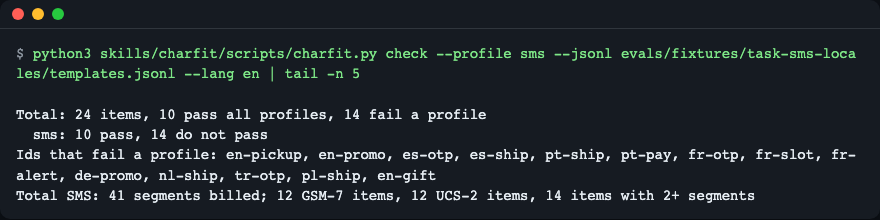
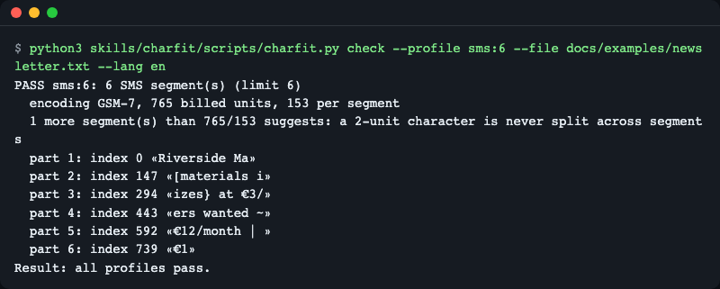
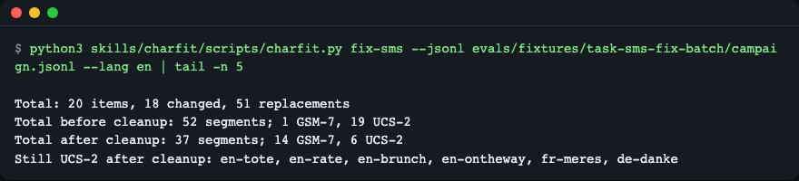
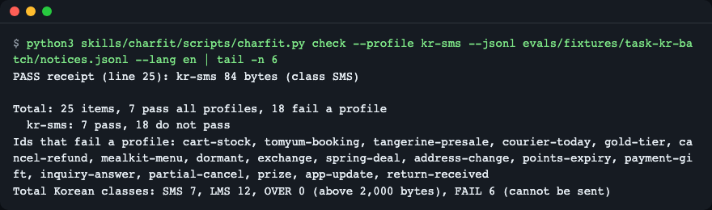
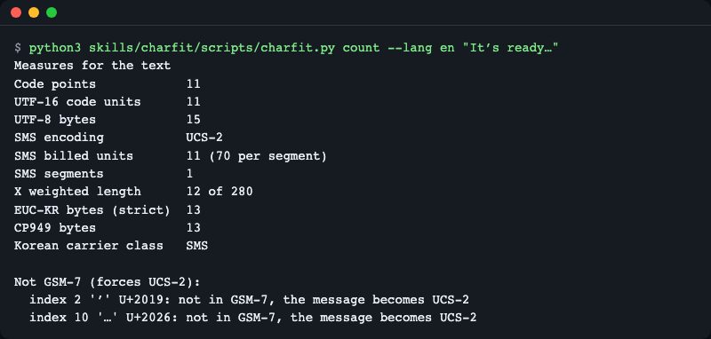

# charfit

**English** | [한국어](README.ko.md)

An agent skill that measures SMS text the way carriers bill it, with a bundled stdlib-only Python script. Give it one message or a whole `templates.jsonl`: it returns billed segments (GSM-7 vs UCS-2), where each segment starts, strict EUC-KR classes for Korean SMS/LMS, and the totals, so the agent reports numbers instead of adding them up. It works offline and gives the same answer every time.


*24 localized templates in one call. The last line is the answer: 41 segments billed, 12 items forced to UCS-2.*

## What it does

Language models count in tokens, not characters, and a hand-made GSM-7 table, `len()` or `ceil(n / 153)` is not a carrier's rule. One wrong item makes a batch total wrong, so `charfit` gives the agent a script to ask.

- **Whole batches in one call.** `--jsonl templates.jsonl` reads one `{"id", "text"}` object per line and prints a result per item plus `totals`: billed segments, GSM-7 and UCS-2 item counts, items with 2+ segments, failing ids.
- **Exact GSM-7 membership.** `é` is GSM-7, `á` is not. A single `á` turns a 120-character message from 1 segment into 2. The table follows 3GPP TS 23.038 and is checked against the `gsm0338` codec.
- **Where each segment starts.** `segment_starts` lists the character position where every segment begins. A two-unit character (`€`, `[`, an emoji) is never split, so starts are not multiples of 153 or 67.
- **GSM-7 cleanup, re-measured.** `fix-sms` replaces curly quotes, dashes, `…` and odd spaces, measures the result again and reports totals before and after. `…` becomes `...` (3 units), so some texts get longer.
- **Strict EUC-KR for Korean SMS/LMS.** Python's `euc_kr` codec encodes Hangul such as `똠` that a Korean carrier cannot send. `charfit` marks those texts `FAIL` and counts `SMS` (90 bytes), `LMS` (2,000 bytes), `OVER` and `FAIL` for a batch. `--kr-codec cp949` gives the extended count.
- **Other limits.** `utf16:N`, `utf8:N`, `chars:N` profiles, and an `x-post` profile for X (see the note in [When to use it](#when-to-use-it)).
- **English and Korean output.** `--lang en|ko`, the `CHARFIT_LANG` variable, or your locale. `--json` is byte-identical in both languages.

Why not just let the agent write a quick script? These are the answers a shortcut gives on the repository's test files (the shortcuts are kept as code in [`tests/naive_baselines.py`](tests/naive_baselines.py)):

| Question | Shortcut | Shortcut answer | `charfit` |
|---|---|---|---|
| Billed segments for 24 localized templates, UCS-2 items | "Latin-1 letters are GSM-7" | 34 segments, 5 UCS-2 items | **41 segments, 12 UCS-2 items** |
| Segment count and where the 3rd and last segment of a 765-unit newsletter start | divide units by 153 | 5 segments, 295 and 593 | **6 segments, 294 and 739** (character positions) |
| Segments after a GSM-7 cleanup of 20 campaign texts | clean up, then divide by 153 or 67 | 33 | **37** |
| Korean notices that cannot be sent (25 notices, strict EUC-KR) | `encode("euc_kr")` | 3 | **6** |

## Install

Prerequisite: Python 3.9 or newer (standard library only, nothing else to install). Install `uv` only if you want to run the tests: `curl -LsSf https://astral.sh/uv/install.sh | sh`.

**Claude Code**
```
/plugin marketplace add LeeGyeongPil/charfit
/plugin install charfit@charfit-skill
```

**Other agents that read the Agent Skills standard** — copy `skills/charfit` into the agent's skills folder (for example `.agents/skills/` in a project).

You can also run the script directly, without any agent:

```
git clone https://github.com/LeeGyeongPil/charfit.git
cd charfit
python3 skills/charfit/scripts/charfit.py count "It’s ready…"
```

## Use it

Ask your agent in plain language. These requests are from the skill's trigger evaluation set:

- "How many SMS segments will this message be billed as? ..."
- "Why is my 120-character text message being sent as 2 parts? ..."
- "Make this promo text GSM-7 safe; replace the smart quotes and ellipsis if needed: ..."
- "이 문구 문자로 보내면 몇 건으로 나가? 이모지 들어가도 괜찮아?" (How many messages will this go out as? Is an emoji OK?)

For a file of templates, add the file name and the agent runs the batch mode. The commands below run from the repository root; the sample files are in `evals/fixtures/` and `docs/examples/`.

**1. A batch of templates** (`check --jsonl`; exit code 0 = every item passes, 1 = at least one does not):

```
$ python3 skills/charfit/scripts/charfit.py check --profile sms --jsonl evals/fixtures/task-sms-locales/templates.jsonl --lang en
PASS en-otp (line 1): sms 1 SMS segment(s) (GSM-7, 111 units, parts start at index 0)
PASS en-ship (line 2): sms 1 SMS segment(s) (GSM-7, 104 units, parts start at index 0)
FAIL en-pickup (line 3): sms 2 SMS segment(s) (UCS-2, 120 units, parts start at index 0, 67)
  - index 10 '’' U+2019: not in GSM-7, the message becomes UCS-2
...
FAIL es-otp (line 6): sms 2 SMS segment(s) (UCS-2, 119 units, parts start at index 0, 67)
  - index 12 'ó' U+00F3: not in GSM-7, the message becomes UCS-2
...
Total: 24 items, 10 pass all profiles, 14 fail a profile
  sms: 10 pass, 14 do not pass
Ids that fail a profile: en-pickup, en-promo, es-otp, es-ship, pt-ship, pt-pay, fr-otp, fr-slot, fr-alert, de-promo, nl-ship, tr-otp, pl-ship, en-gift
Total SMS: 41 segments billed; 12 GSM-7 items, 12 UCS-2 items, 14 items with 2+ segments
```

(`...` marks lines left out here.) With `--json` the same totals are machine-readable: `totals.sms` is `{"segments": 41, "gsm7": 12, "ucs2": 12, "multi_segment": 14}`. The agent quotes these values as they are.

**2. Where do the segments start?** (`check --profile sms:6` allows up to 6 segments):

```
$ python3 skills/charfit/scripts/charfit.py check --profile sms:6 --file docs/examples/newsletter.txt --lang en
PASS sms:6: 6 SMS segment(s) (limit 6)
  encoding GSM-7, 765 billed units, 153 per segment
  1 more segment(s) than 765/153 suggests: a 2-unit character is never split across segments
  part 1: index 0 «Riverside Ma»
  part 2: index 147 «[materials i»
  part 3: index 294 «izes} at €3/»
  part 4: index 443 «ers wanted ~»
  part 5: index 592 «€12/month | »
  part 6: index 739 «€1»
Result: all profiles pass.
```


*The text has 741 characters (`--file` ignores one trailing newline, so `wc -m` shows 742) but 765 billed units, because 24 characters such as `[` and `€` cost 2. The Greek capital `Ω` and `§` are in the GSM-7 alphabet, so they cost 1 and keep the message GSM-7. 765 is exactly 5 × 153, yet the text needs 6 segments: segment 5 is full at 152 units when a `€` begins, and a two-unit character never straddles a boundary, so it moves whole to segment 6. Segment 2 starts at index 147, not 153, for the same reason.*

**3. Clean a batch up for GSM-7** (`fix-sms --jsonl`; exit code 1 means some item is still UCS-2 after cleanup, here because of emoji, `ê` and a backtick used as an apostrophe). The tail of the output:

```
$ python3 skills/charfit/scripts/charfit.py fix-sms --jsonl evals/fixtures/task-sms-fix-batch/campaign.jsonl --lang en
...
Total: 20 items, 18 changed, 51 replacements
Total before cleanup: 52 segments; 1 GSM-7, 19 UCS-2
Total after cleanup: 37 segments; 14 GSM-7, 6 UCS-2
Still UCS-2 after cleanup: en-tote, en-rate, en-brunch, en-ontheway, fr-meres, de-danke
```


*Cleanup saves 15 segments, but six items still need a rewrite by a person. `en-tote` uses a backtick (U+0060) as an apostrophe, and the backtick is not GSM-7; the cleanup only replaces curly quotes, so it leaves the backtick alone. The script never edits your file.*

**4. Korean notices under strict EUC-KR** (`kr-sms` is 90 bytes, `kr-lms` is 2,000 bytes; a text that cannot be encoded is `FAIL`). The tail of the output:

```
$ python3 skills/charfit/scripts/charfit.py check --profile kr-sms --jsonl evals/fixtures/task-kr-batch/notices.jsonl --lang en
...
PASS receipt (line 25): kr-sms 84 bytes (class SMS)

Total: 25 items, 7 pass all profiles, 18 fail a profile
  kr-sms: 7 pass, 18 do not pass
Ids that fail a profile: cart-stock, tomyum-booking, tangerine-presale, courier-today, gold-tier, cancel-refund, mealkit-menu, dormant, exchange, spring-deal, address-change, points-expiry, payment-gift, inquiry-answer, partial-cancel, prize, app-update, return-received
Total Korean classes: SMS 7, LMS 12, OVER 0 (above 2,000 bytes), FAIL 6 (cannot be sent)
```


*"Fail a profile" (18) means above 90 bytes or not encodable. `FAIL` (6) is the carrier class: those texts cannot be sent at all.*

**5. One text** (`count` prints every measure; `check` and `fix-sms` also take a single text, `--file PATH` or `-` for standard input):

```
$ python3 skills/charfit/scripts/charfit.py count --lang en "It’s ready…"
Measures for the text
Code points            11
UTF-16 code units      11
UTF-8 bytes            15
SMS encoding           UCS-2
SMS billed units       11 (70 per segment)
SMS segments           1
X weighted length      12 of 280
EUC-KR bytes (strict)  13
CP949 bytes            13
Korean carrier class   SMS

Not GSM-7 (forces UCS-2):
  index 2 '’' U+2019: not in GSM-7, the message becomes UCS-2
  index 10 '…' U+2026: not in GSM-7, the message becomes UCS-2
```


*One curly apostrophe and one ellipsis turn a GSM-7 message into UCS-2 (70 units per segment instead of 160).*

### Input format of `--jsonl`

One JSON object per line, `text` is required and must be a string, `id` is optional (string or integer; without it the line number is used). Blank lines are skipped. Bad input stops with exit code 2 and the line number, never a traceback. `--jsonl` cannot be combined with TEXT, `-` or `--file`.

```
{"id": "en-otp", "text": "Lumora: your sign-in code is 482019."}
{"id": "es-otp", "text": "Lumora: tu código es 482019."}
```

## Profiles

`--profile P[,P...]` picks the limit to check. Several profiles can be combined.

| Profile | Unit | Limit | Source |
|---|---|---|---|
| `sms` | billed segments | 1 segment: 160 units in GSM-7, 70 in UCS-2 (153 / 67 per segment when split) | [3GPP TS 23.038](https://www.3gpp.org/ftp/Specs/archive/23_series/23.038/), [Twilio](https://www.twilio.com/docs/glossary/what-sms-character-limit) |
| `sms:N` | billed segments | up to N segments | same |
| `kr-sms` | bytes in strict EUC-KR | 90 | [NHN Cloud](https://docs.nhncloud.com/en/Notification/SMS/en/api-guide-v2.4/), [Solapi](https://solapi.com/guides/sms) |
| `kr-lms` | bytes in strict EUC-KR | 2,000 | same |
| `utf16:N` | UTF-16 code units (HTML `maxlength`) | N | [MDN](https://developer.mozilla.org/en-US/docs/Web/HTML/Reference/Attributes/maxlength) |
| `utf8:N` | UTF-8 bytes | N | n/a |
| `chars:N` | code points | N | n/a |
| `x-post` | weighted length (approximation) | 280 | [X docs](https://docs.x.com/fundamentals/counting-characters) |

## JSON output and exit codes

`--json` prints keys in English, identical in both languages. One text, trimmed to the fields that matter (`"Tu código es 4821"` with `--profile sms`):

```
$ python3 skills/charfit/scripts/charfit.py check --profile sms --json "Tu código es 4821"
{
  "pass": true,
  "length": {"code_points": 17, "utf16_units": 17, "utf8_bytes": 18},
  "results": [{
    "profile": "sms", "pass": true, "measure": "sms_segments",
    "value": 1, "limit": 1, "over": 0,
    "culprits": [{"index": 4, "char": "ó", "codepoint": "U+00F3", "reason": "not_gsm7"}],
    "encoding": "UCS-2", "units": 17, "per_segment": 70,
    "extension_chars": 0, "boundary_extra": 0, "segment_starts": [0]
  }]
}
```

(The real output is pretty-printed over more lines; the values are unchanged.)

- `results[].value`, `limit`, `over`, `pass`: the measured value, the limit, how far over it is, and whether it passes. For an unsendable Korean text `value` and `over` are `null`.
- `culprits`: characters that force UCS-2 (or cannot be encoded), with the 0-based code point `index`, the `codepoint` and a `reason`.
- `segment_starts`: code point index where each segment begins (`[]` for an empty text).
- `boundary_extra`: how many segments the "a two-unit character is never cut in half" rule added compared with `ceil(units / per_segment)`. `0` means no boundary effect.
- `--jsonl` adds `items` and `totals` (see [Input format](#input-format-of---jsonl)).

Exit codes: `0` every checked item passes, `1` a limit is exceeded (or, for `fix-sms`, an item is still UCS-2), `2` usage or input error (one `charfit: error:` line, no traceback).

## Language and options

| Setting | Values | Notes |
|---|---|---|
| `--json` | flag | machine-readable output |
| `--kr-codec` | `euc-kr` (default, strict) or `cp949` | `cp949` counts extended Hangul as 2 bytes; use it only if your gateway accepts it |
| `--lang` | `en` or `ko` | then `CHARFIT_LANG`, then `LC_ALL` / `LC_MESSAGES` / `LANG` (a value starting with `ko` means Korean, anything else English) |

## Verified behavior

<!-- skill-eval:start -->
| Check | Result |
|---|---|
| Triggers when it should | 12/12 |
| Stays quiet when it should not | 12/12 |
| Tasks solved with the skill | 5/5 |
| Tasks solved without it (baseline) | 1/5 |
| Mean score gain (Δ) | +0.42 |
| Tasks that catch a broken script | 5/5 |
| Codex CLI | not verified |

Measured 2026-11-27 with Claude Code 2.1.332 · sonnet · 3 runs per case · codex-cli 0.154.0
<!-- skill-eval:end -->

## How it works


1. The agent reads `SKILL.md` when your request is about the length or cost of an SMS, or another text limit.
2. For several texts it runs one `--jsonl` call instead of looping; for one text it passes the text or `--file`.
3. The script reads its arguments, an optional file and standard input, and prints per-item values, culprit characters, `segment_starts` and `totals`. Exit code 1 means a limit is exceeded.
4. The agent reports those values as they are. It does not add up segments or divide units itself.

No network access, no files written by the tool (running the script directly may leave a `__pycache__` folder next to it), no packages beyond Python itself. The rules and their sources are in [`skills/charfit/references/rules.md`](skills/charfit/references/rules.md).

## Rules and limits

- GSM-7 is the 127-character default alphabet plus an escape table (`^ { } \ [ ~ ] |`, form feed, `€`) that costs 2 units. One character outside both makes the whole message UCS-2, counted in UTF-16 units (an emoji is 2).
- Accented letters and Greek capitals are only partly GSM-7 (checked against the `gsm0338` 1.1.0 codec):

| GSM-7 (1 unit) | Not GSM-7 (message becomes UCS-2) |
|---|---|
| é è ù ì ò à ä ö ü ñ ß å ø æ | á í ó ú â ê î ô û ã õ ë ï ÿ œ |
| É Ä Ö Ü Ñ Å Ø Æ Ç | À È Ì Ò Ù Á Í Ó Ú |
| ¡ ¿ £ ¥ § ¤ | ç (lowercase), ł ş ğ ı ő |
| Δ Φ Γ Λ Ω Π Ψ Σ Θ Ξ (Greek capitals) | the other Greek letters, including capitals that look Latin (Α Β Ε ...); the backtick U+0060 |

- Lowercase `ç`: the 3GPP table has only the capital `Ç`. Some providers map `ç` to it; `charfit` follows the table and treats `ç` as UCS-2.
- X: `x-post` is an approximation of X's published rules, cross-checked against twitter-text 3.1.0 (180 of 183 test tokens equal); not a guarantee for every X client.
- Not supported: per-country GSM shift tables (Turkish, Spanish, Portuguese), recipient-pays 152/66 limits, provider storage limits and template rules, grapheme counting. A gateway may count or convert differently.

The full rules are in [`skills/charfit/references/rules.md`](skills/charfit/references/rules.md).

## When to use it

- Fits: template batches in several languages where the segment total changes the bill, long announcements where you need the split points, campaign texts pasted from a CMS, Korean SMS/LMS that must survive strict EUC-KR.
- Does not cover: word counts, LLM token counts, sending messages, translation, per-country GSM shift tables, recipient-pays segment limits (US/Canada), grapheme counting.
- Note on X: the `x-post` profile is an approximation of X's published weighting rules, cross-checked against twitter-text 3.1.0. Emoji sequences and country-code file names are not guaranteed to match every X client, and this is not the focus of the tool.
- For LLM token counts use the tokenizer of the model you call. To send SMS use your provider's API; `charfit` only measures.

## Development

```
uv sync && uv run pytest
```

The `evals/` folder holds 12 trigger cases, 12 not-triggered cases (8 near misses) and 5 task cases with fixtures (the files the cases run against). Run them with `claude plugin eval` (see the Claude Code documentation).

## Sources

All checked 2026-11-23.

- 3GPP TS 23.038 (GSM-7 alphabet): https://www.3gpp.org/ftp/Specs/archive/23_series/23.038/
- Twilio, SMS character limit: https://www.twilio.com/docs/glossary/what-sms-character-limit
- NHN Cloud SMS API guide: https://docs.nhncloud.com/en/Notification/SMS/en/api-guide-v2.4/
- Solapi SMS guide: https://solapi.com/guides/sms
- X, counting characters: https://docs.x.com/fundamentals/counting-characters
- twitter-text v3 configuration: https://raw.githubusercontent.com/twitter/twitter-text/master/config/v3.json
- MDN, HTML `maxlength`: https://developer.mozilla.org/en-US/docs/Web/HTML/Reference/Attributes/maxlength

## License

MIT
